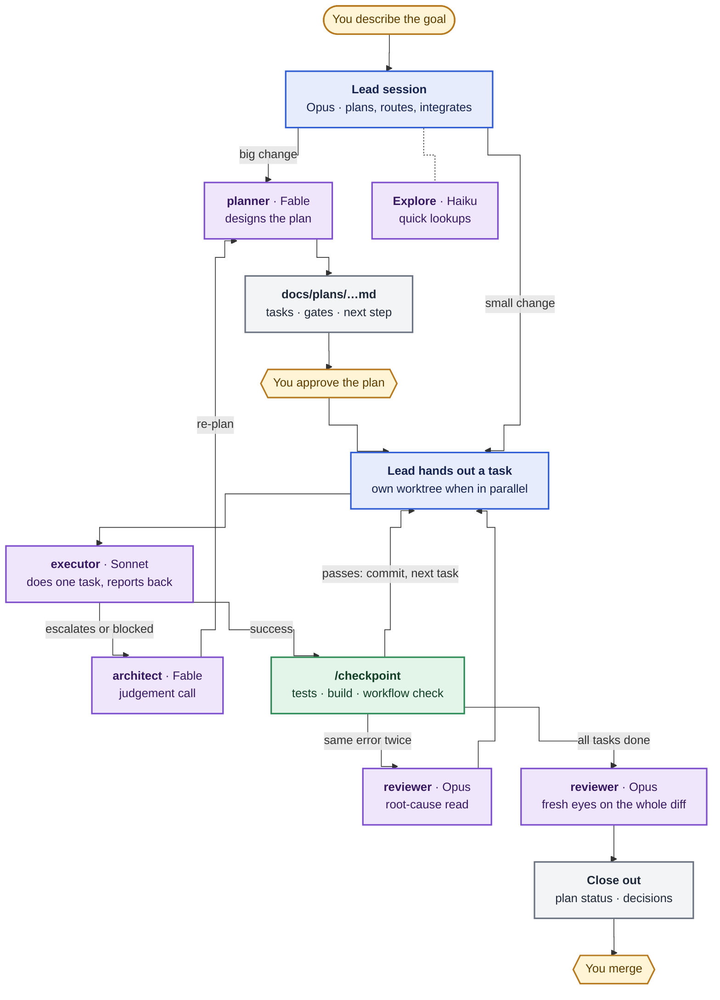
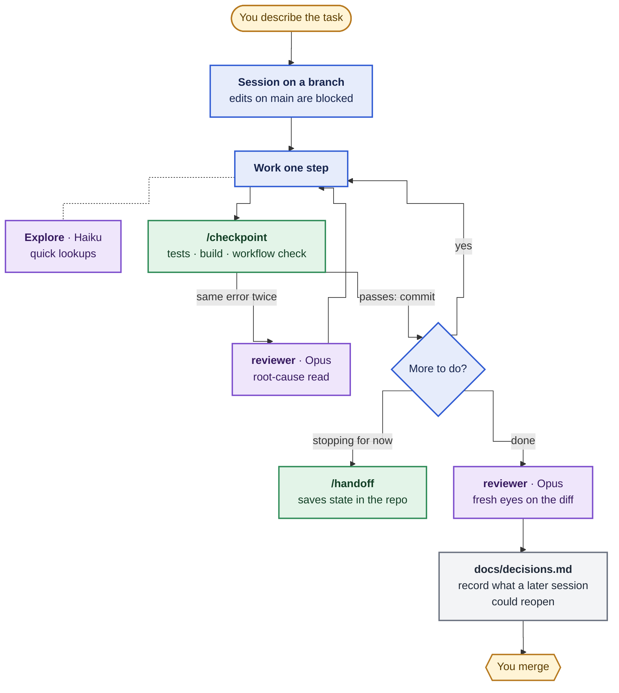

# claude-workflow

A repo-committed agentic workflow for Claude Code, extracted from RiftSight: agent roles with
fixed hand-off formats, review gates, a decisions record and plans, and a check that keeps them
honest.

The kit's files are **copied into each repository and committed**. That is the point: committed
`.claude/` files and `CLAUDE.md` load everywhere the repository goes — local sessions, cloud
sessions, CI and collaborators — whereas a plugin alone does not load in cloud sessions. The
plugin here is only the convenient way to copy the kit in and keep it updated.

## How it works

### Full: one lead, many bounded workers

The lead is the session you talk to. It owns the goal, the plan, integration and every exchange
with you. Workers get one bounded task each and answer in a fixed format, so the lead reads a
short report instead of a whole transcript.



Model routing comes from each agent file's `model:` line: ROUTINE work goes to Sonnet (Haiku for
lookups), STRONG to Opus, FRONTIER to Fable.

### Light: one session, guard rails around it

No planner or executors. The session does the work itself and keeps the same checks: the branch
guard, `/checkpoint`, the two-strikes rule, an independent review and the decisions record.



[docs/workflow.md](docs/workflow.md) covers the rest: where a session's knowledge lives (CLAUDE.md,
decisions, plans, handoffs), when to hand off, and how an unattended run survives a compaction.

## Levels

| | light | full |
|---|---|---|
| `CLAUDE.md` skeleton (seeded) | short | adds orchestration, model routing, closeout |
| Branch guard hook (no edits on `main`/`master`) | ✓ | ✓ |
| `reviewer` (Opus) and `Explore` (Haiku) agents | ✓ | ✓ |
| `checkpoint` skill | ✓ | ✓ |
| `handoff` skill (end a session into the repo, print a starting prompt) | ✓ | ✓ |
| Decisions record (`docs/decisions.md` + theme files, status lines) | ✓ | ✓ |
| Workflow check (`.claude/workflow/check.py`) | ✓ | ✓ |
| `planner`, `architect` (Fable) and `executor` (Sonnet) agents | | ✓ |
| `parallel-work` skill | | ✓ |
| Plans (`docs/plans/` README, template, active-list check) | | ✓ |

Light suits small or rarely changed projects; full suits multi-session programmes.

**Managed** files (agents, skills, the hook, the check, the plan template) are the kit's: `sync`
updates them and never overwrites a local edit. When both the repository and the kit changed a
file, `sync` shows the diff; merge by hand and run `workflow-kit resolve <path>`. To opt out of a
managed file, delete it and run `workflow-kit exclude <path>`. **Seeded** files (`CLAUDE.md`, the
decisions docs, `docs/plans/README.md`, `.claude/workflow.json`) are written once and belong to the
repository; `sync` never rewrites or restores them.

## Install the plugin (your machine)

In Claude Code:

```
/plugin marketplace add ryangswe/claude-workflow
/plugin install workflow@claude-workflow
```

The repository is private, so git on that machine must already have access (`gh auth login` and
`gh auth setup-git`, or an SSH key). Auto-update is off for your own marketplaces by default:
turn it on in `/plugin` → Marketplaces, or run `/plugin marketplace update claude-workflow`.

Then, in any repository:

- `/workflow:init`: choose a level, copy the kit, fill in `CLAUDE.md`, wire the check into CI.
- `/workflow:sync`: update the managed files; `--level full` moves a light repo up.

## Without the plugin (cloud sessions, other machines)

Any Claude session with access to this repository can do the same by hand:

```
git clone --depth 1 https://github.com/ryangswe/claude-workflow /tmp/claude-workflow
python3 /tmp/claude-workflow/plugins/workflow/bin/workflow-kit init --level light --target .
```

then follow `plugins/workflow/skills/init/SKILL.md` from step 4 (fill in `CLAUDE.md`, wire the
check, commit). `status`, `sync [--apply] [--level full]`, `resolve` and `exclude` work the same way.

## What gets checked

`python3 .claude/workflow/check.py` (run it in CI or the test suite):

- `CLAUDE.md` stays under its byte budget (14 KB by default).
- Every skill has a matching `name:` and a description, and is named in `CLAUDE.md` or an agent.
- Every path-scoped rule in `.claude/rules/` has a strict `paths:` header naming real paths.
- The decisions index stays under budget and its lines parse; every theme file is named by a
  heading and every detail entry opens with a status line; every index line's date is backed by
  an entry marked `live, indexed` in its theme file, and every such entry by a line of its date.
  The match is by date, so several same-date lines can rest on one entry.
- The plans' active list agrees with each plan's `Status:` line.

Budgets and the branch guard's exempt folders live in `.claude/workflow.json`.

## Public repositories

Everything the kit writes is committed. For a public repository, decide first whether internal
process notes may be published; `/workflow:init` asks.

## Credits

The `handoff` skill adapts Matt Pocock's `handoff` (github.com/mattpocock/skills, MIT): point at
existing artifacts instead of copying them, name the skills to load, redact secrets. It differs in
writing state into the repository instead of a temp file, so it survives cloud sandboxes and
reaches other machines.

## Developing the kit

- `python3 -m unittest discover -s tests` runs the tests (standard library only).
- `claude plugin validate .` and `claude plugin validate ./plugins/workflow` check the manifests.
- The plugin has no `version`, so installs track the latest commit.
