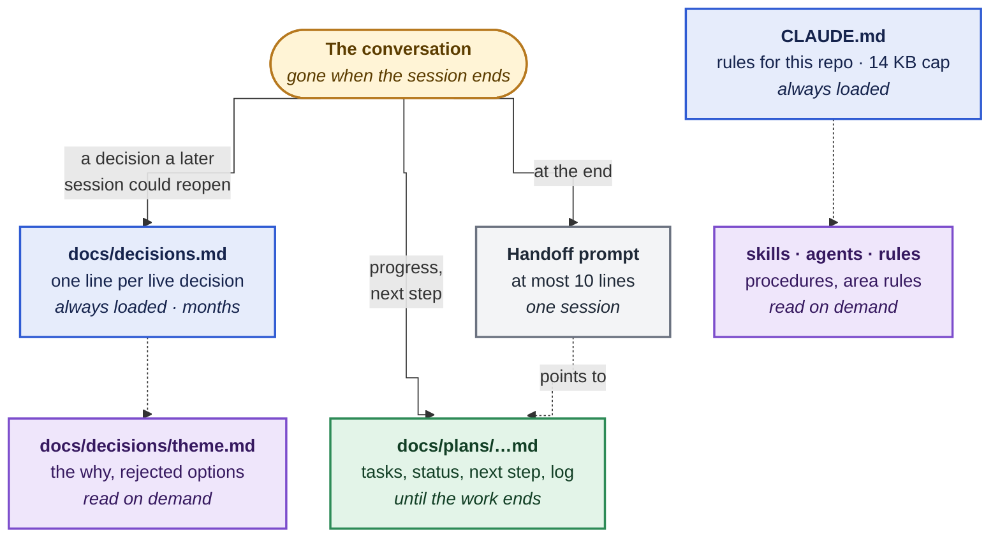
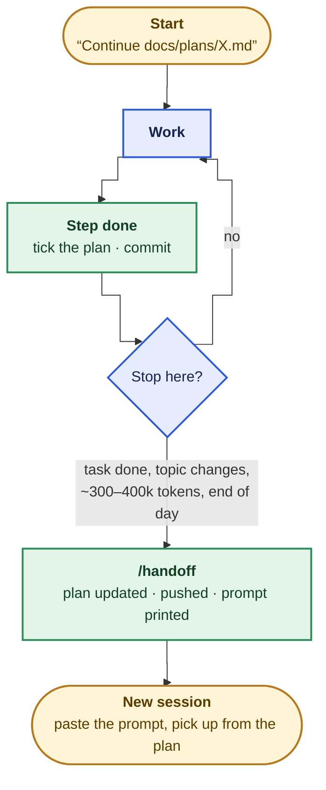
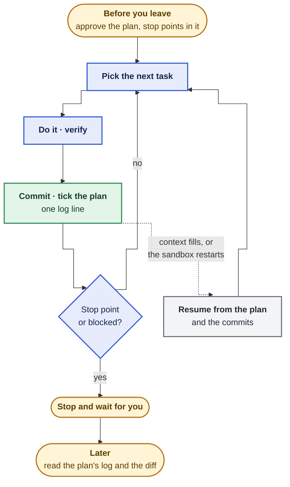
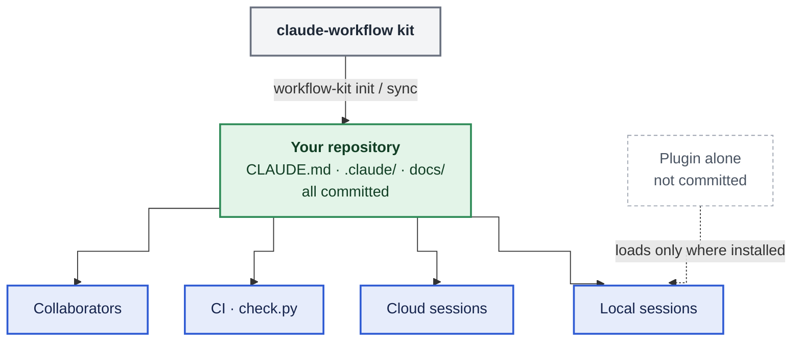

# How the workflow fits together

The [README](../README.md#how-it-works) shows the agent setup at each level. This page shows where
each kind of knowledge lives, and how work carries from one session to the next.

## 1. Where a session's knowledge lives

Every fact is written once, in the layer that matches how long it stays true. Months → a
decision. Until the task ends → the plan. Only for the next session → the handoff, which points at
the plan rather than repeating it.

| Layer | Holds | Lasts | Must not hold |
|---|---|---|---|
| Decisions | Settled choices and why; rejected alternatives | Months, until superseded | Progress, to-dos, today's state |
| Plan | Tasks, status, the next step, the log | Until the work closes | Decisions that outlive it: promote those |
| Handoff | Where to resume, what's uncommitted, which skills to load | One session | Anything already in the plan or a decision |

The layers only clash through copies: a handoff that restates the plan, or a `CLAUDE.md` that
repeats a decision, drifts from its source. Point at the source instead. `check.py` guards the
decisions record and the plans list.

## 2. One session, start to finish

A handoff is a habit at a boundary, not a token alarm. Most happen because the task finished or
the topic changed; the token figure is a backstop for long sessions. If nothing is mid-flight, no
handoff is needed: the plan already says where things stand.

## 3. A session that runs unattended

An overnight run needs no handoff, because nobody switches sessions. What protects it is
committing after every task and keeping the plan current, so a compaction or a restarted sandbox
resumes from files, not memory. The plan's stop points stand in for you: spending, publishing and
merging still wait.

## 4. Why the kit is committed, not just installed

`sync` updates the **managed** files (agents, skills, the hook, the check, the plan template) and
never overwrites a local edit. **Seeded** files (`CLAUDE.md`, the decisions docs, the plans README,
`.claude/workflow.json`) are written once and then belong to the repository.
