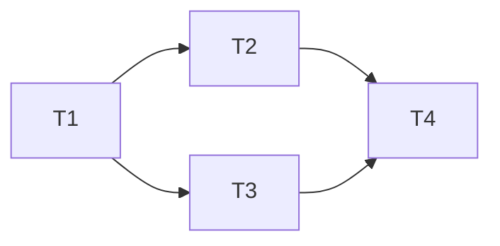

# <Milestone / effort title>

- **Date:** YYYY-MM-DD
- **Status:** Draft | Approved | In progress | Blocked | Done | Closed | Superseded (by …) | Shelved
- **Planned by:** <model/session>
- **Spec / source:** <link or one-line pointer to the request>
- **Branch:** `<branch>`

## Goal

Describe what this effort delivers in 2–4 sentences. State the scope boundary
explicitly: what this deliberately does **not** build yet, and why.

## Approach

Describe the architecture, affected workspaces, important seams, repository invariants,
and any shared-type coupling that requires coordinated changes. Explain the intended
data/control flow where relevant.

## Alternatives considered

- **<Rejected approach>** — <why it was rejected>

Promote decisions worth preserving beyond this effort to `docs/decisions.md`.

## Risks and open questions

- **<Risk or question>** — <impact, evidence, and proposed resolution>

Resolve questions requiring user input before changing the plan from Draft to Approved.

## Dependency summary

Replace the example with the actual task graph. Keep it small enough to scan quickly.

- **Parallel group A:** <tasks that may start together>
- **Parallel group B:** <tasks unlocked together after dependencies complete>
- **Integration order:** <order in which completed changes are combined>

## Task graph

Create independently understandable work units, not one task per file. Separate tasks do
not automatically imply separate agents.

### T1 — <task title>

- **Status:** Pending | In progress | Complete | Escalated | Blocked
- **Dependencies:** None | T<n>, ...
- **Parallel group:** <A/B/...> | Sequential
- **Complexity:** ROUTINE | STRONG | FRONTIER
- **Execution:** Lead session | Executor | Research worker
- **Owner time:** None | <hours: labelling, live checks, decisions>
- **Expected files/workspaces:** `path/...`
- **Objective:** <bounded description of the assigned work>
- **Success criteria:**
  - <observable or testable result>
  - <observable or testable result>
- **Verification:**
  - `<narrow command or manual check>`
- **Escalate if:**
  - <assumption failure or decision outside assigned scope>

### T2 — <task title>

- **Status:** Pending | In progress | Complete | Escalated | Blocked
- **Dependencies:** T1
- **Parallel group:** <A/B/...> | Sequential
- **Complexity:** ROUTINE | STRONG | FRONTIER
- **Execution:** Lead session | Executor | Research worker
- **Owner time:** None | <hours: labelling, live checks, decisions>
- **Expected files/workspaces:** `path/...`
- **Objective:** <bounded description of the assigned work>
- **Success criteria:**
  - <observable or testable result>
- **Verification:**
  - `<narrow command or manual check>`
- **Escalate if:**
  - <assumption failure or decision outside assigned scope>

<!-- Copy the task block as needed. Delete unused examples before approval. -->

## Execution strategy

- **Lead/orchestrator owns:** <architecture, integration, user decisions, etc.>
- **Delegated tasks:** <task IDs and why delegation helps, or None>
- **Model routing:** <task ID → capability class; map to concrete models at execution>
- **Owner time, total:** <hours across all tasks>
- **Approval gates:**
  - user approval before code-writing dispatch
  - user approval before <specific consequential decision>
- **Review strategy:** <when the fresh reviewer runs and what scope it reviews>

### Concurrency and isolation

A parallel group identifies tasks that are eligible to overlap. It does not mean they
will automatically execute concurrently. For every parallelizable task, explicitly state
whether it will actually run concurrently or sequentially.

| Task | Actually concurrent with | Worker/session | Writes files? | Branch/base | Isolation | Shared mutable resources | Integration |
|---|---|---|---:|---|---|---|---|
| T1 | None | Lead | Yes | `<branch/SHA>` | Main checkout | `<dataset/cache/GPU/etc.>` | Direct |
| T2 | T3 | Executor | Yes | `<branch/SHA>` | Worktree | None | Cherry-pick |
| T3 | T2 | Research worker | No | `<branch/SHA>` | Read-only shared checkout | None | Report only |

For each task scheduled to run concurrently, confirm:

- **Execution timing:** Concurrent | Sequential | Deferred
- **Reason:** <why this timing is useful or necessary>
- **Isolation:** Main checkout | Read-only shared checkout | Worktree | External environment
- **Base ref:** `<exact branch or commit>`
- **Tracked inputs available:** Yes | No; <provisioning plan>
- **Shared resources:** None | <datasets, caches, GPU, ports, databases, accounts>
- **Output ownership:** <directories, files, or artifacts owned by this task>
- **Integration method:** Direct | Merge | Cherry-pick | Artifact handoff

## Execution log

Keep the log in a sibling file, `<this plan's name>-log.md`, not here: the plan is the spec a
fresh session executes from, and the log grows with every task. Record material discoveries,
decisions, escalations, and deviations there while work proceeds, in this format. Keep routine
implementation detail out of it.

- **YYYY-MM-DD — <task/status>: <decision or discovery>**
  - **Evidence:** <what was observed>
  - **Impact:** <affected tasks or assumptions>
  - **Resolution:** <decision taken or approval needed>
  - **Permanent decision record needed:** Yes | No (the bar is in the `docs/decisions.md` header)

## Integration and verification

### Integrated checkpoint

- [ ] `/checkpoint` completed (typecheck → test → build → verify)
- [ ] Any checkpoint failures resolved and the checkpoint rerun

### End-to-end acceptance

- [ ] <manual or automated acceptance criterion>
- [ ] <specific surface/mode exercised>
- [ ] <failure or recovery path exercised>

### Independent review

- **Reviewer:** <agent/model>
- **Verdict:** Pending | Pass | Changes required
- **Findings:** <link or concise summary>
- [ ] Material findings resolved
- [ ] Relevant verification rerun after fixes

## Completion summary

- **Delivered:** <concise outcome>
- **Deviations from approved plan:** None | 

- **Known risks / follow-up:** None | 

- **Decision records updated:** None | `docs/decisions.md` entries
- **Lesson:** NO_ENTRY | cue: <the shape of situation, not this plan's facts> / lesson: <what to
  do differently, naming where it would live: CLAUDE.md, an agent file, a skill, a hook or a
  test> / evidence: <the moment in this plan that shows it> / confidence: <high, medium or low>

<!-- At most one lesson, about how the work was run, not what it built. NO_ENTRY is the usual
answer; a lesson resting on a single ambiguous moment is a guess. -->
